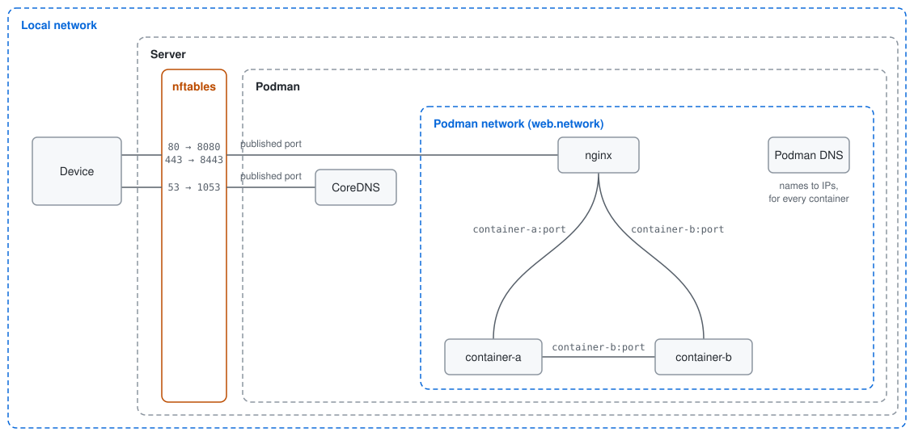

# Development

How to change the repo. Most changes are adding or changing a service: start with
[Adding a service](#adding-a-service).

## The repo

```
containers/                       every Quadlet unit, one file per service
├── container.d/00-common.conf    shared settings applied to every container
├── core/                         every host
├── lan/                          local network mode only
├── vpn/                          internet mode: both VPNs' units, each named after its VPN
│                                 (netbird-*, headscale*): only the chosen one's are linked
├── media/                        optional, media stack
├── vault/                        optional, photos, contacts, documents
│   └── immich/                   an app with several containers, in a folder of its own
└── ai/                           optional, AI models run on the server
config/                           config files the apps read, mounted read-only
env.example                       example of the host's env file, which holds its settings
                                  ⚠️ NEVER put secrets or sensitive info in it
scripts/                          install, update, helper and utility scripts
templates/                        a starting point for a new service's unit
```

## The Hearthbox user's home

The home directory of the Hearthbox user, which runs the stack, after Install:

```
~/
├── .config/containers/systemd/   maps to the repo's containers/
├── .local/bin/hearthbox            the CLI
└── appdata/                      the containers' data, this host's CA (ca/), and the
                                  host's env file

/srv/hearthbox/                     files shared between services: media/, downloads/,
                                  photos/, created by the services that mount them
```

What the apps write goes in `~/appdata`, never in the repo. Config you write lives in
the repo.

## Adding a service

The example throughout is `myapp`, a web app added to the media group.

### 1. Pick its group

Each folder in `containers/` is a group. See [services](services.md) for group
information.

A service that doesn't belong to any group goes directly in `containers/`, and runs on
every host.

An app with several containers (its own database, cache, ...) can keep them in a
folder of its own inside its group, like `vault/immich/`. The folder only groups the
files: each file still needs a name no other service has (`immich-postgres`, not
`postgres`), since services and containers are named after their file.

### 2. Write its unit

`containers/media/myapp.container`:

```ini
[Unit]
Description=MyApp

[Container]
Image=docker.io/example/myapp:2
Network=web.network
# The port nginx's sites.conf and Glance use
Environment=MYAPP_PORT=8098
Volume=%h/appdata/myapp/config:/config:Z
Volume=/srv/hearthbox:/data
```

- **Image:** always pinned, never `latest`, so the repo decides what runs. If the image
  publishes a major-version tag, use it (`jellyfin:12`): updates bring its fixes, and a
  new major version waits for you to change the tag. Before 1.0, the minor version
  counts as the major one, if the image publishes one. Otherwise pin the exact version
  (`glance:v0.8.7`, `netbird-server:0.83.1`, LinuxServer's `version-<app version>`).
- **Networks:** `web.network` gives it proxy server access: nginx reaches it there,
  and so do the other services on it. A service can be on any number of networks, one
  `Network=` line each, e.g. an app's own network for its database, which nothing else
  should reach. A service nginx doesn't route to and that talks to no other container
  (CoreDNS) needs no `Network=` line: it gets Podman's default network.
- **Settings:** as `Environment=` lines, when the app reads them from its environment,
  each with a comment saying why the value is what it is. They apply at every start
  and the app never writes them into its own files, so the repo always wins.
- **Port:** set it with the app's own setting, so the port is decided in the repo. It
  must match the nginx map line and the dashboard's `check-url` (steps 3 and 4). Each
  container has its own IP, so another service using the same port doesn't matter.
- **Data the app writes** (database, its own settings): a folder in
  `~/appdata/<service>/`, mounted with `:Z`. The service creates it when it starts.
- **Files shared with other services:** `/srv/hearthbox`, mounted without options.
- **Config files the app only reads:** put them in `config/<service>/<folder>/` and
  mount that folder read-only: `Volume=%h/repo/config/myapp/config:/etc/myapp:ro,Z`.
  Nothing renders them: a value only known on the host comes from the container's
  environment, and the app fills it in itself. For the internal domain, add
  `Environment=INTERNAL_DOMAIN=${INTERNAL_DOMAIN}` and use the app's own variable syntax
  (CoreDNS's `{$INTERNAL_DOMAIN}`, Glance's `${INTERNAL_DOMAIN}`; Headscale reads any of
  its settings as `HEADSCALE_<key>`). The exception is NetBird's server, which can't
  read the internal and public domains from its environment: an `ExecStartPre=` script
  fills them into a copy of its config at every start
  (`scripts/containers/render-netbird-config.sh`).
- **Secrets** never go in the repo, so never in a `.container` file. A secret the app
  needs is a Podman secret its unit creates the first time (`ExecStartPre=`) and passes
  in with `Secret=`, like Immich's database password.
- **No `PublishPort=`** for a web UI: nginx routes to it. Publish only traffic nginx
  can't carry, like qBittorrent's torrent port.

`containers/container.d/00-common.conf` already gives every unit its container name,
the local time, the Hearthbox user, the env file (`${INTERNAL_DOMAIN}`), restarts
and start at boot: don't repeat them. To change one for a single service, add a drop-in
instead of editing the unit, e.g. for an image that must run as its own user:

```ini
# containers/media/myapp.container.d/50-user.conf
[Container]
UserNS=
User=
Group=
```

With SELinux (Fedora, RHEL), `:Z` labels a folder for the one container that mounts it
(`:ro,Z` when read-only). Never use it on system paths (`/etc/localtime`) or
`/srv/hearthbox`, which Install labels once. Without SELinux, Podman ignores it.

### 3. Give it an address

Add a line to the `map` in `config/nginx/conf.d/sites.conf`: the name becomes
`myapp.<internal-domain>`, and the port is the one its unit sets.

```nginx
    myapp        myapp:8098;
```

nginx's HTTPS certificate names every service in the map: at nginx's next start
(`hearthbox update`), `scripts/containers/renew-cert.sh` signs a new one with
`myapp.<internal-domain>` in it. CoreDNS in local mode, and NetBird's
`*.<internal-domain>` record in internet mode with NetBird, answer every name under the
internal domain. Headscale gets one record per name in the map, written at its next
start, which `hearthbox update` also does (`scripts/containers/headscale-records.sh`).
Both read the map's names with `scripts/containers/service-names.sh`. So nothing more is
needed. Never name a service `nbs`, `hs` or `ca`: those names are reserved (see
`sites.conf`).

### 4. Add it to the dashboard

In `config/glance/config/widgets/dashboards.yml`:

```yaml
    - title: MyApp
      url: https://myapp.${INTERNAL_DOMAIN}
      check-url: http://myapp:8098
      icon: sh:myapp
```

### 5. Apply it

```bash
hearthbox update                    # links the unit, creates its folders, starts it
hearthbox services list             # myapp should be active
hearthbox services logs myapp       # if it isn't
```

Then open `https://myapp.<internal-domain>`, and add the service to [services](services.md).

## Changing the scripts

Each step is its own script, named after what it does: `scripts/install/` for steps
only Install needs, `scripts/` for steps that apply the repo (Install, `hearthbox pull`
and `hearthbox update`). The loop in `install.sh` orders Install's steps, and the loop
in `scripts/update.sh` orders the others. Scripts the units run when a container
starts (`ExecStartPre=`) aren't steps: they go in `scripts/containers/`. Code two steps
share, like `scripts/install/public-name.sh` (the wait for the VPN server's public name,
in `setup-netbird` and `setup-headscale`), is sourced, not a step.

- Steps run as the Hearthbox user. A step that needs root has a `# Runs as: root` line,
  and Install runs all of those first: the user's steps need what they set up (the
  user, its `~/repo`, lingering). The exceptions are the last steps, after the services
  start: `setup-router` in local mode (CoreDNS must answer before the router hands it
  out), and `setup-netbird` or `setup-headscale` in internet mode (they need the VPN's
  server running).
- Variable names: uppercase for values passed to another script through the
  environment (`HEARTHBOX_USER`, `REPO`, `SERVICE_GROUPS`, `INTERNAL_DOMAIN`), lowercase
  for values used only in the script that sets them.
- A list used once, like the steps a script runs, goes straight into its loop.

## How the network works



The containers' IPs exist only inside the Hearthbox user's network namespace. From the
LAN or the host, a container is reachable only through a port its unit publishes, and
another user's containers can't reach `web.network` at all.

- Services on the same network reach each other by container name. Every service
  nginx routes to is on `web.network`. Podman picks each network's subnet, and nginx
  reads Podman's DNS server from the container at every start
  (`config/nginx/templates/`), so no network address is written in the repo.
- nginx picks the service from the first part of the hostname, so it doesn't need the
  internal domain.
- In local mode, CoreDNS is the network's DNS server: it answers the internal domain and every
  name under it with this machine's address, and sends the rest to the router. It
  finds both addresses at every start (`scripts/containers/find-lan.sh`). Devices use it once the
  router hands it out.
- In internet mode, the devices and this machine are in a VPN, NetBird or Headscale.
  Its server (`vpn/netbird-server.container` or `vpn/headscale.container`) is reachable
  from the internet at `nbs.<public-domain>` or `hs.<public-domain>`, on port 443
  (redirected to its 9443) and 3478 (UDP). This machine joins its own network with the
  VPN's client, a root system service that Install's last step installs.
- With NetBird, the client is on the `wt0` interface. `setup-netbird` also creates a
  NetBird DNS zone whose `*.<internal-domain>` record is a CNAME to this machine's own name in
  NetBird (`netbird status`), which NetBird keeps pointed at its current address: the
  services' names follow when the address is edited in the dashboard, or the network's
  range changes. NetBird's dashboard (`netbird-dashboard`) is a service in nginx's map
  like the others, at `netbird.<internal-domain>`.
- With Headscale, the client is Tailscale's, on the `tailscale0` interface. Headscale
  gives every device one DNS record per service, and one for `ca`, pointing at this
  machine's address on `tailscale0`: not a wildcard, since the Tailscale app only looks
  up exact names. `scripts/containers/headscale-records.sh` writes them at every
  Headscale start (the map), and at every change of that address (`ip monitor`), in the
  background inside Headscale's service, logged as `headscale-records`. Headscale reloads
  them without a restart. Its config
  (`config/headscale/config.yaml`) uses only its own relay, not Tailscale's, gets its
  certificate from Let's Encrypt with TLS-ALPN-01 (port 443 only), turns MagicDNS off,
  and has no access policy: every device reaches every other.
- Every service is HTTPS. Install's `create-ca` step creates this host's certificate
  authority in `~/appdata/ca/`, whose root certificate can only sign names under the
  internal domain. `scripts/containers/renew-cert.sh`, run at every nginx start, signs nginx's
  certificate with it, naming every service in the map: one name each, since browsers
  refuse a wildcard right under a single-label domain like `hearthbox`. nginx serves the
  root certificate at `http://ca.<internal-domain>/root.crt`, and redirects every other plain HTTP
  request to HTTPS.
- Rootless Podman can't bind ports 80, 443 and 53. Install's nftables rules
  (`/etc/hearthbox.nft`, loaded by `hearthbox-nftables.service`) redirect 80 and 443 to
  nginx's 8080 and 8443, and 53 to CoreDNS's 1053: from any interface and the machine
  itself in local mode, only from the VPN's interface (`wt0` or `tailscale0`) in internet
  mode. In internet mode, port 443 from anywhere else, and from the machine itself, goes
  to the VPN's server, so the machine can't open the services itself. Traffic to 8080,
  8443 or 1053 that wasn't redirected is dropped. The rules hold no IP, so they keep
  working when an address changes. `systemctl disable --now hearthbox-nftables` removes
  them.

## Your own version of the setup

Install puts a git clone of the repo in `~<hearthbox-user>/repo`. To change the setup, edit
that copy, then run `hearthbox update`. New versions from this
repo merge with your changes when you `hearthbox pull`, and your changes stay on that one
machine.

To share your changes, work on them with others, or install the same setup on another
machine, fork this repo to your own Git host, set `repo_url` at the top of your fork's
`install.sh` to your fork, and install with your fork's `install.sh`. You can still pull
new versions from this repo into it.

## How Install and updates work

### Install

First, `install.sh` stops if nft, Podman or git is missing (it installs no packages
itself), or if the distro's Podman is older than 5.2 (the shared `container.d/` drop-in
needs it). Run from curl, it then clones the repo from `repo_url` into a temporary
folder, which it deletes however it ends. Run from a clone (`sudo ./install.sh`), it
uses that clone instead, as it is, including changes you haven't committed.

Then it asks which user to install for, where the services will be reached from
(internet asks Headscale or NetBird, and a public domain; it also needs curl, and with
Headscale stops if Tailscale is already installed other than in `/usr/local/bin`), the
internal domain, and which optional service groups you want. It lists everything it will
do, and waits for you to confirm before changing anything else.

On a host with an installation, finished or not (`/etc/hearthbox.env` exists), it
continues that installation instead: it takes the user from `/etc/hearthbox.env` and the
other answers from `~/appdata/.env` if an earlier run saved them, and asks only what's
missing. Steps already done skip or repeat unchanged: the user, `~/repo` (copied whole
or not at all) and the CA are kept. So an Install that was cut off, by a dropped SSH
session for example, continues when run again, and there is never a second
installation for another user. A new user must not exist yet: Uninstall deletes the
user with its home, so it must be one Install created.

It creates the Hearthbox user (no password, so nobody can log in as it directly: use
`sudo -iu <hearthbox-user>`; `useradd` also gives it the subuid/subgid ranges rootless
Podman needs) and copies the clone into `~<hearthbox-user>/repo`, keeping its git history
and `origin`. Before anything else, it records the Hearthbox user in `/etc/hearthbox.env`,
so `uninstall.sh` finds it even after an Install that stopped halfway.

It also enables lingering so the Hearthbox user's services start at boot, writes
`/etc/profile.d/hearthbox.sh` so `systemctl --user` works after `sudo -iu` (switching
users starts no session, so nothing else sets `XDG_RUNTIME_DIR`), creates
`/srv/hearthbox` and hands it, with anything already in it, to the Hearthbox user (labelled for
containers, if SELinux is on), sets up the port 80 and 443 redirects, and in local mode
the DNS one, enables the Podman API socket for Glance, and creates the certificate
authority. None of these depend on the repo, so `hearthbox` doesn't repeat them. Then it
applies the repo, the same way `hearthbox update` does. In local mode, it ends with
`setup-router`: it waits until your router hands out this machine as DNS server, renews
this machine's connection where it knows how, and checks it. In internet mode, it ends
with `setup-netbird`: NetBird's client, its owner, and its DNS zone; or `setup-headscale`:
the Tailscale client, Headscale's user, and this machine joining. If the
VPN's server doesn't answer at its public name yet, that step waits and checks again when
you press Enter.

### Starting over

To change the internal domain or switch between local and internet, run `uninstall.sh`, then
Install: Install run again continues with the saved settings, it doesn't change them.
Uninstall deletes `~/appdata` with every app's data, the VPN's users and devices and the
CA, and keeps `/srv/hearthbox`. The new Install hands everything in `/srv/hearthbox` to its
new user, which may have another user ID than the old one, so the services can write to
it again.

Some parts are only set up by Install, as root, so `hearthbox pull` doesn't update them on
an installed host: the VPN's client on this machine (it keeps its version when a pull
updates the VPN's server) and the port redirects. A version that changes either reaches
a host when Install runs again: it installs the client version the repo pins, which runs
from the next reboot. Known limitation: Headscale supports only the last 10 Tailscale
client releases, so after pulls update Headscale, this machine's client can fall out of
its support until Install runs again with a newer pinned client.

### Optional groups

A host runs the groups listed in `SERVICE_GROUPS` in `~/appdata/.env`, which
Install fills in: lan, netbird or headscale from the local/internet questions, then the
optional groups you tick. To change them later, edit that line and run `hearthbox update`,
which links and starts a new group's services and stops a removed one's. lan, netbird
and headscale aren't optional groups (their units are in `containers/vpn/`, each named
after its VPN, and `link-repo.sh` links only the chosen one's, since both servers publish
the same ports): they come with the port redirects and the VPN's client, which only
Install sets up. A group the repo adds later isn't installed on hosts that already exist
until you add it there.

### hearthbox pull and hearthbox update

Both run as the Hearthbox user and need no root.

- **`hearthbox update`** applies `~/repo` as it is, including uncommitted edits, and never
  changes it.
- **`hearthbox pull`** first gets new versions with `git pull --ff-only`, then does the
  same. It needs `~/repo` to have a git remote, and says so if it doesn't. If `~/repo`
  has commits of its own, it stops instead of merging: pull with git, resolve any
  conflicts, then run `hearthbox update`.

Applying the repo, from the Hearthbox user's clone:
- create the links shown in the [Hearthbox user's home](#the-hearthbox-users-home). If a
  link's path already exists and isn't a link, it stops and names the path: move it or
  delete it, then run again. Links the repo no longer has are removed.
- download every image the units use, one at a time, before anything starts: the
  newest version of a major-version tag like `jellyfin:12`, and no start limit for a
  big image on a slow connection. Without internet access this fails, and nothing is
  restarted. Each image's copy for `UserNS=keep-id`, which Podman makes at its first
  container on storage that can't shift IDs, is made here too, for the same reason.
- check every unit with `systemd-analyze verify`, and stop if one is broken, then stop
  services whose unit is gone and restart every service

Each service creates the `~/appdata` and `/srv/hearthbox` folders it mounts right before
it starts (`scripts/containers/create-folders.sh`, run by `container.d/00-common.conf`), however
it's started.

### After git pull

Install sets `core.hooksPath` in the Hearthbox user's clone to the repo's
`scripts/hooks/`, so the hooks there run after every `git pull` (`post-merge`, or
`post-rewrite` for `git pull --rebase`) and come from the repo like everything else.
They run `link-repo`, so a pull that adds a service or a link has its links in place.
They don't restart anything: run `hearthbox update` when you want the
changes live. Pull as the Hearthbox user: git refuses to work in a repo another user
owns, and other users can't read its home.

A pull that stops on a conflict runs no hook, and finishing the merge with
`git commit` doesn't run one either. After resolving one, run `hearthbox update`.
